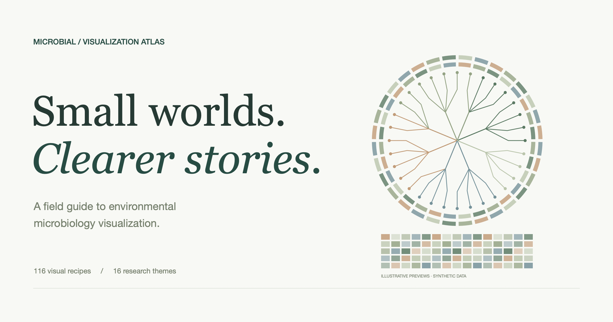

# Environmental Microbiology Visualization Atlas

A literature-informed, illustrated website for exploring scientifically defensible environmental microbiology visualizations.

**[Explore the live atlas](https://skate-debug.github.io/microbial-visualization-atlas/)** · [GitHub repository](https://github.com/skate-debug/microbial-visualization-atlas)



**116 formats and applied recipes · 16 subject families · 19 study and method references**

Start with the [full visualization catalogue](docs/visualization-catalogue.md), the [journal and figure reference atlas](docs/journal-atlas.md), or the [design and project guide](docs/design-and-project-guide.md).

This resource covers soil, water, sediment, subsurface, engineered ecosystems, bacterial and archaeal communities, fungi, microbial eukaryotes and viruses. It includes amplicon sequencing, metagenomics, genomes, environmental chemistry, time series, multi-omics and imaging. Individual recipes require the corresponding measurements; a single project should use only the relevant subset.

## Catalogue at a glance

| Family | Recipes | Representative formats |
| --- | ---: | --- |
| Study design and geography | 8 | Sampling maps, environmental overlays, prediction maps, transects, experimental schematics |
| Sampling, diversity and distributions | 9 | Rainclouds, violins, ECDFs, rank abundance, rarefaction, Hill profiles |
| Composition, occurrence and set membership | 10 | Annotated heatmaps, dot matrices, ternary plots, UpSet, alluvial diagrams |
| Ordination and environmental gradients | 7 | PCoA/NMDS, biplots, environmental vectors, trajectories, Procrustes, distance decay |
| Effects, differential abundance and associations | 8 | Forest plots, volcano/MA plots, paired changes, response curves, correlation matrices |
| Time series and disturbance dynamics | 7 | Aligned trajectories, temporal heatmaps, time–depth sections, lag and frequency displays |
| Taxonomy, phylogeny and evolution | 6 | Annotated phylograms, circular metadata trees, tree–heatmap composites, tanglegrams |
| Comparative and population genomics | 9 | Genome tracks, synteny, Circos, pangenomes, gene clusters, read recruitment, variant landscapes |
| Viromes, hosts and mobile genetic elements | 6 | Virus–host networks, CRISPR matrices, gene-sharing networks, AMG composites, integration context |
| Ecological networks and relational structure | 6 | Module networks, adjacency matrices, chords, focal subnetworks, comparative networks |
| Function, metabolism and biogeochemistry | 8 | Pathway heatmaps, enrichment, element cycles, measured-flux Sankeys, reaction maps |
| Multi-omics integration | 5 | Aligned heatmaps, cross-omics matrices, latent factors, contribution matrices, multipartite graphs |
| Microscopy, spatial ecology and single cells | 8 | Fluorescence images, segmented cells, spatial statistics, 3D volumes, isotope maps, embeddings |
| Prediction and machine-learning assessment | 8 | Prediction scatterplots, ROC/PR, confusion matrices, calibration, residuals, model explanations |
| Ecological assembly and mechanistic models | 6 | Variation partitioning, neutral models, turnover quadrants, process proportions, path models |
| Data quality, uncertainty and robustness | 5 | Missingness, genome quality, sensitivity analyses, null distributions, measurement controls |

Each entry records its scientific use, minimum data, a design suggestion, its main interpretation limit, evidence status and reference locator. These are formats **and applied compositions**, not 116 unrelated chart primitives.

## Literature foundation

Flagship examples include the [Earth Microbiome Project in Nature](https://www.nature.com/articles/nature24621), the [Tara Oceans microbiome in Science](https://doi.org/10.1126/science.1261359), the [global ocean virome in Cell](https://doi.org/10.1016/j.cell.2019.03.040), and the [global topsoil microbiome in Nature](https://www.nature.com/articles/s41586-018-0386-6). The atlas also identifies relevant Nature Portfolio titles and original method papers by their actual journal names.

The catalogue distinguishes **43 direct examples**, **20 proposed adaptations**, and **53 additional proposals**. A direct example verifies the encoding used in the cited figure or method; it does not imply that every design recommendation or environmental application appears in that paper. This is a curated resource, not a systematic review or a claim to exhaustive journal coverage. Literature was checked on 27 October 2026.

## A focused first gallery

Begin with sampling maps, raincloud distributions, community ordinations, annotated heatmaps, abundance–prevalence dot matrices, effect-size interval plots and UpSet plots. Add tree–metadata displays, synteny, virus–host graphs, biogeochemical-cycle maps and temporal composites when those data are available. The [project guide](docs/design-and-project-guide.md) explains these twelve starting designs and six possible scientific narratives.

## Repository contents

```text
README.md
docs/
  visualization-catalogue.md      # Complete list with decision guidance
  journal-atlas.md                # Sources and exact figure locations
  design-and-project-guide.md     # First gallery, styling and implementation
data/
  catalogue.json                 # Machine-readable recipe records
  references.json                # Structured source metadata
templates/
  visualization-recipe.md        # Reusable specification for an example
scripts/
  build_docs.py                  # Dependency-free Markdown generation
  build_site.py                  # Build the GitHub Pages site
  check_site.py                  # Check content, links and assets
website/                         # HTML, CSS, JavaScript and local assets
tests/
  catalogue.test.mjs             # Search, shortlist, export and preview checks
.github/workflows/pages.yml      # Automated checks and Pages deployment
```

The website includes illustrated previews for all 116 recipes, keyword search, research-theme and evidence filters, curated collections, recipe detail dialogs, shareable recipe URLs, a browser-local shortlist with Markdown export, and the reference reading room. Previews are deterministic synthetic illustrations of formats; they are not analyses of empirical datasets. No accounts, analytics or backend services are required.

## Run the website locally

The site uses HTML, CSS and browser JavaScript. Building requires only Python 3; there are no npm dependencies.

```bash
python3 scripts/build_site.py
python3 scripts/check_site.py
python3 -m http.server 4173 --directory dist --bind 127.0.0.1
```

Open `http://127.0.0.1:4173/`. Serve it over HTTP rather than opening the HTML file directly, because the catalogue loads JSON files.

To run the JavaScript checks with Node.js:

```bash
node tests/catalogue.test.mjs
```

## GitHub Pages deployment

The workflow in [.github/workflows/pages.yml](.github/workflows/pages.yml) checks the JavaScript and catalogue, builds `dist/`, validates its assets, and deploys it to GitHub Pages on pushes to `main`. The publishing source is **GitHub Actions**.

Website source is in [website/](website/). Content lives in the existing JSON records; downloadable documents are copied into the site during the build. Relative asset paths support the GitHub Pages project subdirectory and shareable recipe links such as `?recipe=PHY02`.

Fonts are self-hosted, with licence texts included. Map outlines come from Natural Earth. See [asset attribution](website/assets/ATTRIBUTION.md).

## Maintain the catalogue

Edit the JSON records, then run:

```bash
python3 scripts/build_docs.py
```

This rebuilds the full catalogue and journal atlas. Keep this overview’s counts synchronized when adding or removing entries. The website reads the JSON catalogue directly; add a matching preview in `website/previews.js` for each new recipe.

For each implemented example, retain source data, its data dictionary, transformation code, caption, reproducible rendering instructions and an accessible static export. Add scientific insight through complementary panels and appropriate encoding; visual complexity alone is not a project objective.
